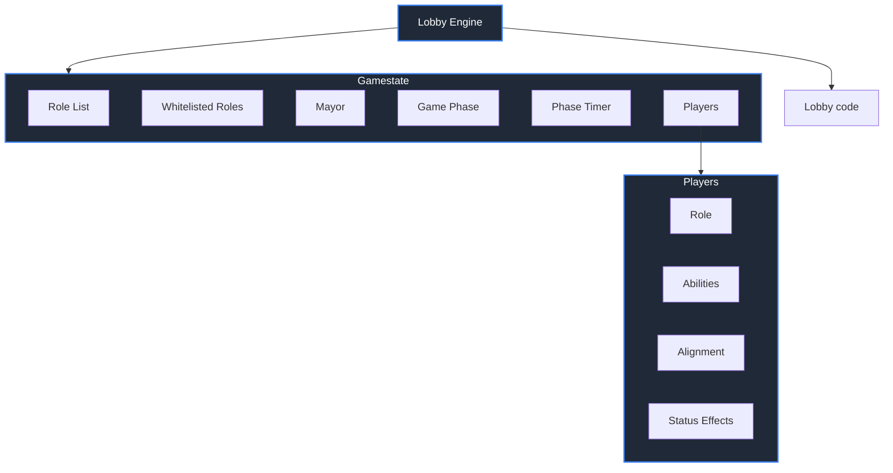

# Death and Taxes
Death and Taxes is an economic mafia game that aims to solve the problems with its genre, namely the stagnant metas and mechanical emphasis thereof, designed and balanced by a veteran of five years. 
You can play at: [Death and Taxes](https://cyanberri.github.io/) 
Design doc: https://docs.google.com/document/d/1bkjgXSM3wrh7IcS8mrba2LaKZo9LbH_su0DsECTMX78/edit?usp=sharing

## Game overview
Death and Taxes was designed primarily to emphasise the *social* aspect of the social deduction game. 

Everyone has a special power here; no boring Townies! But that's not why *this* game is special.

The Mayoral Elections here require an attentive Town to make the most of it by electing the right person with the parliament ability the Town needs right now. 

A steady economy of Coins, where each player can give them away to others, gives another point for Town to read off of; whos giving whom coins, who keeps their promises, etc. 

Mechanical deduction takes a side seat here as many of the investigative roles have numerous possible explanations as to what happened that night, while anyone who can directly expose evils are forced into hiding.
This game avoids getting stale as each game whitelists a subset of roles that can spawn and can come with modifiers that shake things up even more.

## Architecture
This is a Mafia-style game written in HTML, connected to a server in C++ (using the Crow and Nlohmann libraries.)
The Server is hosted on Render. Due to Render's spindown policy, the first log-in attempt in a while will typically result in the server taking around a minute to spin up. As such, an authorisation token will not have been generated by the time you enter a gamemode resulting in an error. Just reload the page and type your username again to fix this.
(You may have also noticed code that is supposed to connect to Supabase. I'd rather get passwords working *before* implementing progression, so that's why it currently does absolutely nothing.)

This game uses data-driven architecture, as follows. As such, the server remains single-threaded, removing headaches with race conditions.

This game currently has 15 implemented roles (for the full Bed of Roses list). I'm not counting the <b>Mayor</b> since it's more of a status than a role.

Implemented Roles

  <b>Town Enforcers</b> 
  🟢Sheriff 
  🟢Gunner 
  <b>Common Town</b> 
  🟢Coroner 
  🟢Gambler 
  🟢Doctor 
  🟢Vigilante 
  🟢Merchant 
  🟢Deputy 
  <b>Salient Mafia</b> 
  🔴Godfather 
  🔴Jackal 
  <b>Common Mafia</b> 
  🔴Consigliere 
  🔴Sniper 
  🔴Framer 
  <b>Neutral Killing</b> 
  🔵Serial Killer 
  🔵Amnesiac 

The rest should be coming quickly after I test if the overall structure is fun or not (and get passwords set up)

### Technical difficulties
So the issue with a mafia-like game is that it kinda needs multiple people and frankly I'm not a good marketter so it's a bit dead.
Regardless, the game works. One can test this by opening several tabs on one device.

Also, linking in c++ is a nightmare. Getting Crow to work was kinda a miracle and I'm currently trying to link bxcrypt and supabase for passwords and player items.

### Game's Design
Mafia-based social deduction games currently on the market are, well, *questionable*. 

I wanted to change that.

This game is loosely modelled on Throne of Lies, which features the King. The King is a role assigned to a player and if the King dies, you can elect a new King. It's similar to the Mayor in this regard.
However, the choice of who to elect as King in that game is... a bit daft - since all that really matters is that you give the crown to Blue Dragon (or a neutral whose role you want out, such as the Inquisitor or Sellsword).
So instead, I decided to give each role a <b>Parliament Ability</b>, which makes the question of who to elect as Mayor a lot more interesting, as you have to both consider whether or not they're Town - *and* whether or not their Parliament Ability is what Town needs right now.

In addition, I've built a pretty solid understanding of what makes a mafia game interesting over the years, and have spotted these problems in mainline games:
- Follow the Cop metas. Protectors in most current games can just camp a player the whole game (especially evident in Wolvesville), so Investigative roles have no fear in simply posting their info.

While Town of Salem has the Conjurer, that role typically hunts Town Power instead.
 I've addressed this issue by adding the Town (Inspection) subalignment to clearly declare a strong info role that Mafia want out (currently only hosting the Sheriff) - and giving them ways to remove them, i.e., the Sniper and Jackal can bypass the Doctor, and the Consigliere can find them if they're hiding.
- Confirmation. This one plagues a LOT of games.

Town of Salem has Jailor, Vigilante, Veteran, Transporter, Tracker, Lookout, Trapper, Crusader and Mayor. Spy as well, but only because it makes Investigator and Tavern Keeper impossible to fake (and is flat out unfakeable in Coven All Any).
 Its sequel has all the Town (Power) roles and Trapper. Due to Secret Killers in Ranked, the Town (Killing) roles and Crusader are fine, though.

Wolvesville... has an awful rolelist. Every role is confirmed, there's zero claimspace. Also, even if they weren't, you have Witch tree and Mayor tree clogging up what claimspace there should have been.

Throne of Lies isn't as bad due to conversion, but there's the Prince and the Mystic. Butler, Drunk, Court Wizard, Observer, etc still require you being a particular class to fake them.

I've simply made roles less confirmable and info more shaky. Gambler is a hard alignment check, sure, but due to players being able to give coins at night, it's easy for them to get a false positive. Two Sheriff claims? This game doesn't flip roles after death, so you don't know who's the real one.
Causes of death are also hidden, so that Vigilante claim? could just be a Jackal.

- Death. There currently does not exist a game where dead players consistently have a meaningful impact on the game.

So I allowed them to talk, in exchange for not revealing their role.

- Stagnant metas. Almost every game goes the same way:
Town of Salem/Throne of Lies: Everyone claims roles/alignments day 2, you hang a passive, heavily counterclaimed player (or follow an investigative's lead), move on.

Wolvesville: The 2 informers claim, push their info if any, everyone else says literally nothing, vigi rando-reveals if no leads found, medium instantly revives, etc. It doesn't help that every setup is basically just a different flavour of the pervading skeleton.
Wolvesville is especially awful, since killing due to a social read counts as "random-killing" *and can get you banned.*

This one is the most egregious in my opinion, because players are forced into it as anyone defecting is hanged instantly - including new players who have no clue what the meta is. Town of Salem in particular... yeah, newbies who don't know how to claim are often called throwers. Such beginner-friendliness.

That said, this is actually mostly a result from the above issues. Follow the Cop is strong since it works, and forcing players to claim is what enables it. 
Confirmability means at some point, confirmed townies outnumber unconfirmed townies - and without extra kills, evils can't do anything. Everyone claiming is the fastest way to achieve that.
As such, roles that bypass protection and a lack of confirmability directly prevent Town from hardclaiming early - and removing dead players' roles flipping means that even if players try to claim the same confirmed slot (such as an extra night death), Town has to spend a kill on one of them.

With mechanical deduction toned down, this opens the doors for... well... *social* deduction. And Coins is the way I've decided to exacerbate that. Players can give each other coins, which directly grant them more role powers.
This makes coins a direct currency that can be traded for trust, and gives players something else to read other than just the chat.

### Credits
This was a solo project entirely by me.

